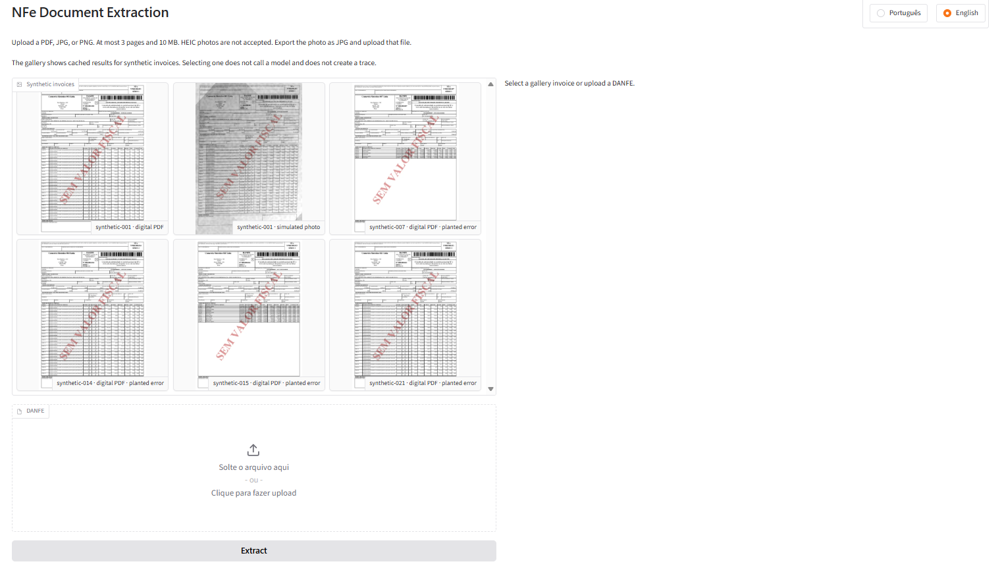

# NFe Document Extraction

[](https://github.com/OtnielGomes/NFe-Document-Extraction/actions/workflows/checks.yml)

[](LICENSE)
[](https://docs.smith.langchain.com/)

[](https://langchain-ai.github.io/langgraph/)
[](https://platform.openai.com/docs)
[](Dockerfile)

**English** · [Português](README.pt-BR.md)

The model reads a Brazilian DANFE. The code decides whether that reading can be trusted. Header and line-item agents extract the invoice; a deterministic validator, one repair attempt, and human review accept or hold each field.

> [!NOTE]
> This repository is still in development. Evaluation, tracing, and monitoring already run through LangSmith. The public demo is not deployed yet. A later push to `main` is planned to publish a Hugging Face Space; see [`docs/deploy.md`](docs/deploy.md).

## How the metrics chose the design

Two measured passes, both scored locally and uploaded to LangSmith when a key is present, fixed the design and then the model.

The first pass, in [`docs/results-smoke.md`](docs/results-smoke.md), compared four extraction approaches on a sample of 10 synthetic invoices per row. Pricing table date: 2026-10-03. Baseline, cheap vision, and the text layer used `gpt-4.1-mini-2025-04-14`. Strong vision used `gpt-4.1-2025-04-14`. That pass kept section agents plus the deterministic validator, and kept cheap vision: it reads a simulated photo, which the text layer cannot, and it costs less than strong vision.

| Pass | Rendition | Field accuracy | Cost per invoice (USD) | Errors reaching Human review |
| --- | --- | --- | --- | --- |
| First test, cheap vision | digital PDF | 0.9721 | 0.007105 | 9 |
| First test, cheap vision | simulated photo | 0.5736 | 0.008941 | 8 |

The second pass kept cheap vision and compared `gpt-4.1-mini-2025-04-14` with `gpt-6-luna` (Responses API, reasoning effort none) and the structured Header and Line items prompts. LangSmith traces and the same metrics selected `gpt-6-luna`. The adopted rows are the cheap-vision rows in [`docs/results.md`](docs/results.md). Pricing table date: 2026-10-08. The mini arm of that comparison is not repeated here.

| Pass | Rendition | Field accuracy | Cost per invoice (USD) | Errors reaching Human review | Planted-error detection rate |
| --- | --- | --- | --- | --- | --- |
| Adopted, cheap vision | digital PDF | 0.9870 | 0.002035 | 8 | 1.0000 |
| Adopted, cheap vision | simulated photo | 0.6420 | 0.002367 | 9 | 1.0000 |

On the adopted sample, digital field accuracy rose from 0.9721 to 0.9870 and cost fell from US$ 0.007105 to US$ 0.002035. Simulated-photo field accuracy rose from 0.5736 to 0.6420. Planted-error detection on the adopted rows is 1.0000. The full adopted table, including the other approaches, is in [`docs/results.md`](docs/results.md).

## Walkthrough

Quality checks run without calling a model. The first experiment is the smoke eval. The later charts are the configuration measured before deploy.


The local interface is Portuguese by default, with English on the page. These shots show a clear synthetic invoice, a real DANFE, a phone photo of a real DANFE, and visitor feedback recorded in LangSmith.




## Run

Requires Python 3.12+ and [uv](https://docs.astral.sh/uv/).

```bash
uv sync
uv run python scripts/check.py
```

`scripts/check.py` runs the formatter, the linter, the type checker, and the test suite. It does not call a model.

Copy [`.env.example`](.env.example) to `.env` and set `OPENAI_API_KEY` before an eval. LangSmith is optional. When `LANGSMITH_API_KEY` is set, the same run uploads as an experiment.

```bash
uv run python scripts/run_eval.py --limit 2
```

`--limit 2` scores the first examples (one NF-e, digital PDF then simulated photo) and rewrites `docs/results.md`. Omit `--limit` for the full synthetic set. Add `--trace` to trace model calls.

The local UI and JSON API:

```bash
uv run python -m nfe_document_extraction.app
```

Open `http://127.0.0.1:7860`. Uploads call the model and need `OPENAI_API_KEY`.

## Case study

Architecture, the baseline comparison, validator and repair counts, limitations, and next steps: [`docs/case-study.md`](docs/case-study.md).
