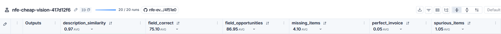

# Extração de documentos de NF-e

[English](README.md) · **Português**

O modelo lê um DANFE. O código decide se essa leitura pode ser confiada. Agentes de cabeçalho e de itens extraem a nota; um validador determinístico, uma tentativa de reparo e a revisão humana aceitam ou retêm cada campo. Os números abaixo vêm somente da tabela gerada em [`docs/results.md`](docs/results.md).

> [!NOTE]
> Este repositório ainda está em desenvolvimento. Avaliação, tracing e monitoramento já passam pelo LangSmith. A demonstração pública ainda não foi publicada. Um push futuro em `main` deve publicar um Space na Hugging Face; veja [`docs/deploy.md`](docs/deploy.md).

## Resultados

Amostra de 10 notas sintéticas por linha (`synthetic-001` a `synthetic-010`), PDF digital e depois foto simulada. A visão barata adotada é `gpt-6-luna` (Responses API, reasoning effort none) com os prompts estruturados de cabeçalho e de itens ([ADR 0008](docs/adr/0008-cheap-vision-adopts-gpt-6-luna.md)). Data da tabela de preços: 2026-10-08. A tabela gerada completa, incluindo visão forte e camada de texto, está em [`docs/results.md`](docs/results.md).

| Abordagem de extração | Rendição | Acurácia de campos | Custo por nota (USD) | Erros que chegam à revisão humana | Taxa de detecção de erro plantado |
| --- | --- | --- | --- | --- | --- |
| single-call baseline | digital PDF | 0.9322 | 0.003345 | 0 | 1.0000 |
| single-call baseline | simulated photo | 0.5677 | 0.003186 | 0 | 1.0000 |
| cheap vision | digital PDF | 0.9870 | 0.002035 | 8 | 1.0000 |
| cheap vision | simulated photo | 0.6420 | 0.002367 | 9 | 1.0000 |
| text layer + text model | digital PDF | 0.9870 | 0.004457 | 5 | 1.0000 |

Nesta amostra, a visão barata empata com a camada de texto na acurácia digital (0.9870) a um custo menor (US$ 0.002035 contra US$ 0.004457) e lê fotos simuladas, o que a camada de texto não faz. A linha de base de uma chamada envia 0 documentos à revisão humana no PDF digital porque não repara, e a acurácia digital é menor (0.9322). O reparo corrigiu 0 documentos em todas as linhas publicadas. A detecção de erro plantado é 1.0000 e documentos limpos rejeitados é 0.



## Como a avaliação escolheu o modelo

O LangSmith é a plataforma de tracing, experimentos offline e monitoramento. A avaliação em si continua local: `scripts/run_eval.py` pontua em Python puro e grava `docs/results.md` sem conta no LangSmith. Com `LANGSMITH_API_KEY`, a mesma execução sobe como experimento.

A decisão da visão barata foi um ciclo avaliação → trace → mudança → avaliação na amostra reiniciada da tabela (10 documentos por rendição). Uma passagem anterior no conjunto sintético completo não entrou na decisão. A linha adotada é o passo 2: `gpt-6-luna` com os prompts estruturados. Nessa linha, o custo digital fica abaixo do teto de comparação registrado na [ADR 0008](docs/adr/0008-cheap-vision-adopts-gpt-6-luna.md), a detecção de erro plantado permanece 1.0000 e nenhum documento limpo é rejeitado. A revisão humana na foto simulada é 9. O relato de cada passo medido está no [estudo de caso](docs/case-study.md) e na [ADR 0008](docs/adr/0008-cheap-vision-adopts-gpt-6-luna.md). Aqui só se repetem cifras que também aparecem em `docs/results.md`.

## Executar

Requer Python 3.12+ e [uv](https://docs.astral.sh/uv/).

```bash
uv sync
uv run python scripts/check.py
```

`scripts/check.py` roda formatador, linter, checagem de tipos e a suíte de testes. Não chama modelo.

Copie [`.env.example`](.env.example) para `.env` e defina `OPENAI_API_KEY` antes de uma avaliação. O LangSmith é opcional.

```bash
uv run python scripts/run_eval.py --limit 2
```

`--limit 2` pontua os primeiros exemplos (uma NF-e, PDF digital e depois foto simulada) e reescreve `docs/results.md`. Sem `--limit`, o conjunto sintético inteiro entra. `--trace` rastreia as chamadas ao modelo. `scripts/sync_dataset.py` envia o conjunto sintético quando há chave do LangSmith.

Interface local (português por padrão, inglês na página) e API JSON:

```bash
uv run python -m nfe_document_extraction.app
```

Abra `http://127.0.0.1:7860`. Envios chamam o modelo e precisam de `OPENAI_API_KEY`.

## Estudo de caso

Arquitetura, comparação com a linha de base, contagens do validador e do reparo, limitações e próximos passos: [`docs/case-study.md`](docs/case-study.md) (em inglês, conforme a [ADR 0007](docs/adr/0007-readme-and-case-study-format.md)).
