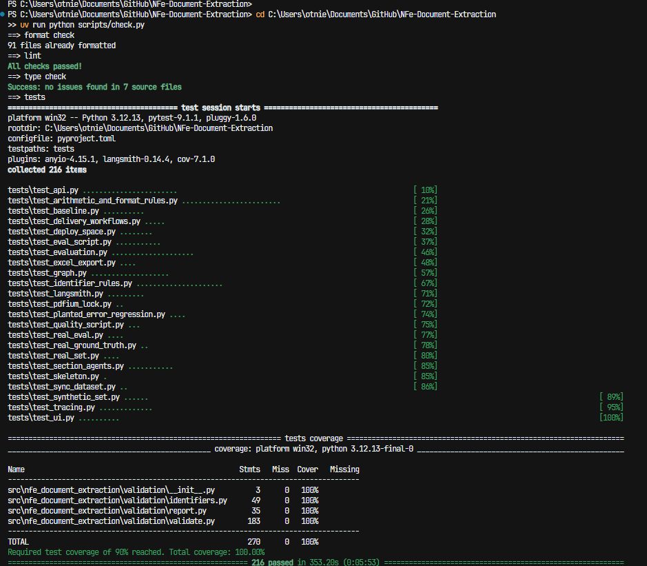
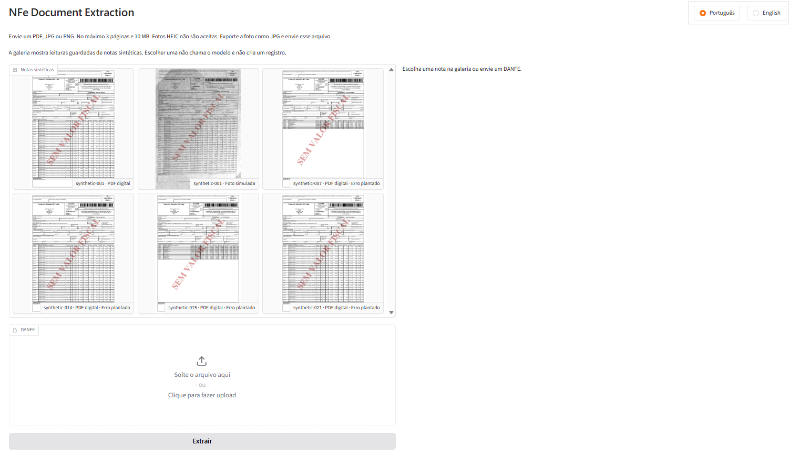
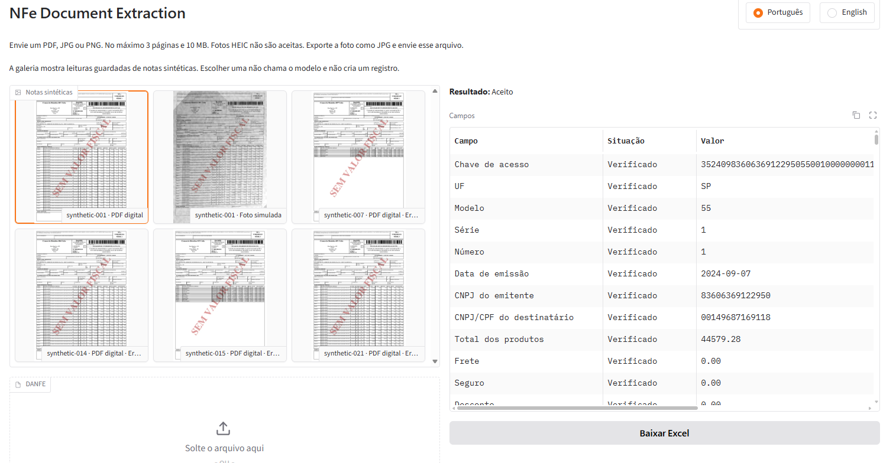
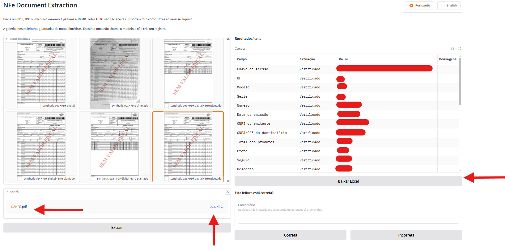
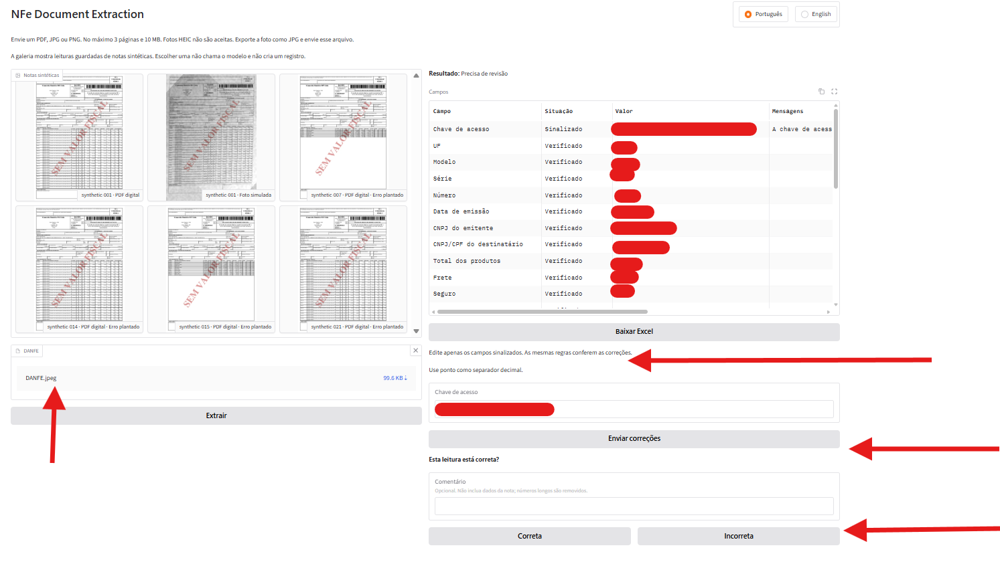
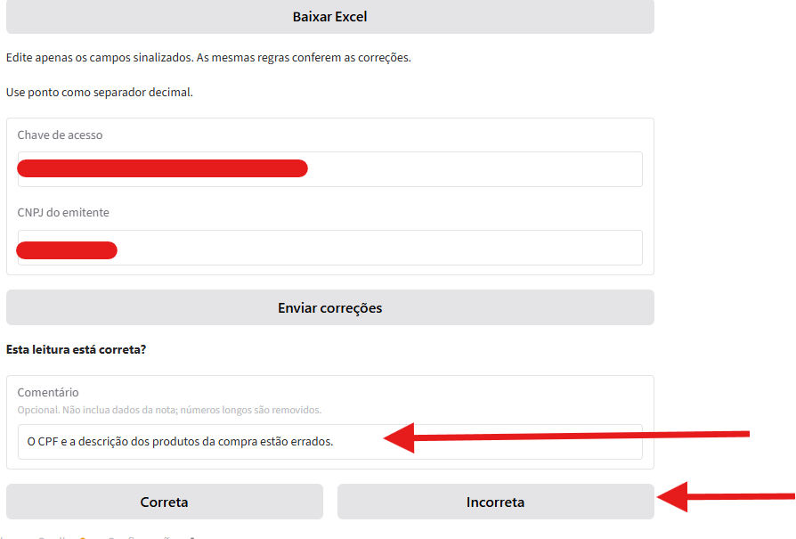
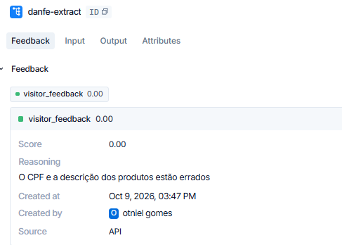

# Extração de documentos de NF-e

[English](README.md) · **Português**

O modelo lê um DANFE. O código decide se essa leitura pode ser confiada. Agentes de cabeçalho e de itens extraem a nota; um validador determinístico, uma tentativa de reparo e a revisão humana aceitam ou retêm cada campo.

> [!NOTE]
> Este repositório ainda está em desenvolvimento. Avaliação, tracing e monitoramento já passam pelo LangSmith. A demonstração pública ainda não foi publicada. Um push futuro em `main` deve publicar um Space na Hugging Face; veja [`docs/deploy.md`](docs/deploy.md).

## Como as métricas escolheram o desenho

Duas medições, pontuadas localmente e enviadas ao LangSmith quando há chave, fixaram o desenho e depois o modelo.

A primeira, em [`docs/results-smoke.md`](docs/results-smoke.md), comparou quatro abordagens de extração numa amostra de 10 notas sintéticas por linha. Data da tabela de preços: 2026-10-03. A linha de base, a visão barata e a camada de texto usaram `gpt-4.1-mini-2025-04-14`. A visão forte usou `gpt-4.1-2025-04-14`. Essa passagem manteve os agentes de seção com o validador determinístico, e manteve a visão barata: ela lê foto simulada, o que a camada de texto não faz, e custa menos que a visão forte.

| Passagem | Rendição | Acurácia de campos | Custo por nota (USD) | Erros que chegam à revisão humana |
| --- | --- | --- | --- | --- |
| Primeiro teste, visão barata | digital PDF | 0.9721 | 0.007105 | 9 |
| Primeiro teste, visão barata | simulated photo | 0.5736 | 0.008941 | 8 |

A segunda passagem manteve a visão barata e comparou `gpt-4.1-mini-2025-04-14` com `gpt-6-luna` (Responses API, reasoning effort none) e os prompts estruturados de cabeçalho e de itens. Os traces no LangSmith e as mesmas métricas selecionaram `gpt-6-luna`. As linhas adotadas são as de visão barata em [`docs/results.md`](docs/results.md). Data da tabela de preços: 2026-10-08. O braço com o mini nessa comparação não é repetido aqui.

| Passagem | Rendição | Acurácia de campos | Custo por nota (USD) | Erros que chegam à revisão humana | Taxa de detecção de erro plantado |
| --- | --- | --- | --- | --- | --- |
| Adotado, visão barata | digital PDF | 0.9870 | 0.002035 | 8 | 1.0000 |
| Adotado, visão barata | simulated photo | 0.6420 | 0.002367 | 9 | 1.0000 |

Na amostra adotada, a acurácia digital subiu de 0.9721 para 0.9870 e o custo caiu de US$ 0.007105 para US$ 0.002035. Na foto simulada, a acurácia subiu de 0.5736 para 0.6420. A detecção de erro plantado nas linhas adotadas é 1.0000. A tabela adotada completa, com as outras abordagens, está em [`docs/results.md`](docs/results.md).

## Percurso

Os testes de qualidade não chamam modelo. O primeiro experimento é o eval de fumaça. Os gráficos seguintes são a configuração medida antes do deploy.





A interface local é em português por padrão, com inglês na página. Os prints mostram uma nota sintética nítida, um DANFE real, a foto de um DANFE real e o feedback do visitante registrado no LangSmith.













## Executar

Requer Python 3.12+ e [uv](https://docs.astral.sh/uv/).

```bash
uv sync
uv run python scripts/check.py
```

`scripts/check.py` roda formatador, linter, checagem de tipos e a suíte de testes. Não chama modelo.

Copie [`.env.example`](.env.example) para `.env` e defina `OPENAI_API_KEY` antes de uma avaliação. O LangSmith é opcional. Com `LANGSMITH_API_KEY`, a mesma execução sobe como experimento.

```bash
uv run python scripts/run_eval.py --limit 2
```

`--limit 2` pontua os primeiros exemplos (uma NF-e, PDF digital e depois foto simulada) e reescreve `docs/results.md`. Sem `--limit`, o conjunto sintético inteiro entra. `--trace` rastreia as chamadas ao modelo.

Interface local e API JSON:

```bash
uv run python -m nfe_document_extraction.app
```

Abra `http://127.0.0.1:7860`. Envios chamam o modelo e precisam de `OPENAI_API_KEY`.

## Estudo de caso

Arquitetura, comparação com a linha de base, contagens do validador e do reparo, limitações e próximos passos: [`docs/case-study.md`](docs/case-study.md).
