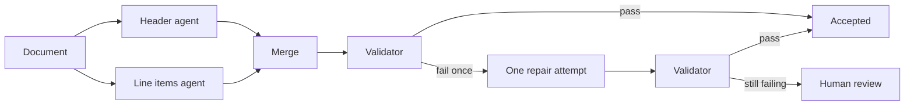
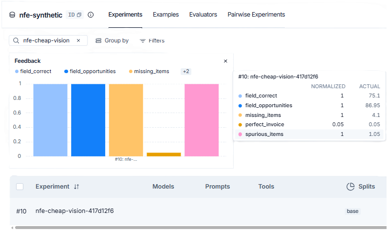
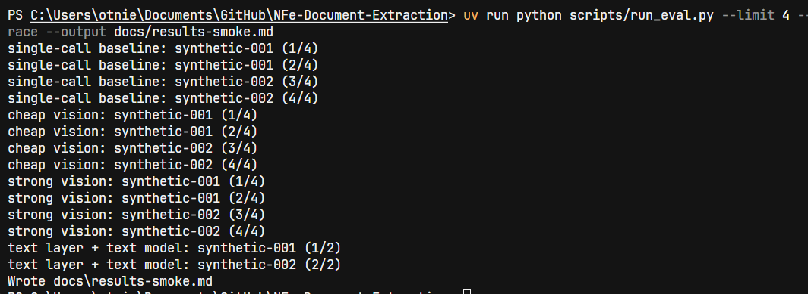

# Case study: trusting a DANFE reading

The LLM reads the invoice. The code decides whether the reading can be trusted. This write-up is the long form of [README.md](../README.md). Every published number is taken from [`results.md`](results.md), which `scripts/run_eval.py` generates. Do not treat any other document as a source of scores.

The published table is a restarted sample: 10 synthetic invoices per row (`synthetic-001` through `synthetic-010`), digital PDF then simulated photo. Phone-photo and real-invoice rows are not in that file yet. The public demo is not deployed. Evaluation, tracing, and monitoring already use LangSmith ([ADR 0003](adr/0003-local-first-eval-with-langsmith.md)). Deploy to a Hugging Face Space is described in [`deploy.md`](deploy.md) and has not run.

## Problem

A DANFE is the printed view of a Brazilian electronic invoice (NF-e). Downstream work needs structured header fields and line items, plus an explicit statement of which fields failed a check. A model that always returns JSON can still invent a total that matches the lines, drop a row, or misread a photo. Those failures are expensive when they look valid.

The product therefore splits reading from acceptance. Section agents propose values. A deterministic validator applies the rules. One repair attempt may run. What still fails goes to human review. The single-call baseline exists so the split is compared with data, not assumed ([ADR 0001](adr/0001-section-agents-with-deterministic-validator.md)).

## Architecture

Both section agents see the whole document in parallel. No supervisor model chooses the route. Repair sends each flagged field back to the agent that owns it. A rule that spans both sections (line items sum to total products) sends the same message to both agents inside that single attempt. Human edits pass through the same rules as model output. The demo UI is Portuguese by default and English on the page; the validator and the API stay in English ([ADR 0009](adr/0009-interface-translation-at-presentation.md)).

Pinned models (`src/nfe_document_extraction/agents/models.json`, pricing as of 2026-10-08):

| Extraction approach | Model |
| --- | --- |
| single-call baseline | `gpt-4.1-mini-2025-04-14` |
| cheap vision | `gpt-6-luna` (Responses API, reasoning effort none) |
| strong vision | `gpt-4.1-2025-04-14` |
| text layer + text model | `gpt-4.1-mini-2025-04-14` |

`gpt-6-luna` is a rolling model id. It has no immutable dated snapshot. The other three ids are snapshots.

## Results

Definitions are in the header of [`results.md`](results.md). Field accuracy is an exact match after normalization. Planted-error documents are excluded from field accuracy and scored by detection rate. The text layer does not apply to photos.

| Extraction approach | Rendition | Origin | Documents | Field accuracy | Description similarity | Perfect-invoice rate | Cost per invoice (USD) | Latency median (s) | Latency p95 (s) | Errors caught by the validator | Errors fixed by repair | Errors reaching Human review | Planted-error detection rate | Extraction errors | Clean documents rejected |
| --- | --- | --- | --- | --- | --- | --- | --- | --- | --- | --- | --- | --- | --- | --- | --- |
| single-call baseline | digital PDF | synthetic | 10 | 0.9322 | 1.0000 | 0.0000 | 0.003345 | 5.931 | 30.466 | 9 | 0 | 0 | 1.0000 | 0 | 0 |
| single-call baseline | simulated photo | synthetic | 10 | 0.5677 | 0.9808 | 0.0000 | 0.003186 | 6.291 | 28.669 | 8 | 0 | 0 | 1.0000 | 1 | 0 |
| cheap vision | digital PDF | synthetic | 10 | 0.9870 | 1.0000 | 0.1000 | 0.002035 | 6.027 | 18.418 | 8 | 0 | 8 | 1.0000 | 0 | 0 |
| cheap vision | simulated photo | synthetic | 10 | 0.6420 | 0.9672 | 0.0000 | 0.002367 | 6.581 | 15.491 | 9 | 0 | 9 | 1.0000 | 0 | 0 |
| strong vision | digital PDF | synthetic | 10 | 0.6907 | 1.0000 | 0.0000 | 0.035147 | 8.467 | 40.786 | 9 | 0 | 9 | 1.0000 | 0 | 0 |
| strong vision | simulated photo | synthetic | 10 | 0.3183 | 0.9409 | 0.0000 | 0.037734 | 8.597 | 45.680 | 9 | 0 | 9 | 1.0000 | 0 | 0 |
| text layer + text model | digital PDF | synthetic | 10 | 0.9870 | 1.0000 | 0.4000 | 0.004457 | 5.136 | 31.073 | 5 | 0 | 5 | 1.0000 | 0 | 0 |

Compare a digital PDF row with the simulated photo row of the same approach to see the drop from PDF to photo. Cheap vision falls from 0.9870 to 0.6420. The single-call baseline falls from 0.9322 to 0.5677. Strong vision falls from 0.6907 to 0.3183.

## Single-call baseline versus section agents

The baseline is one cheap call (`gpt-4.1-mini-2025-04-14`) with no repair. On digital PDF it reaches field accuracy 0.9322, description similarity 1.0000, perfect-invoice rate 0.0000, cost US$ 0.003345, and sends 0 documents to human review. The validator still caught errors on 9 of 10 documents; none were repaired, and the baseline's review count stays 0 because that approach does not route failures into human review the way section agents do.

Cheap vision, the adopted section-agent configuration, reaches digital field accuracy 0.9870 and description similarity 1.0000 at US$ 0.002035, with perfect-invoice rate 0.1000. It sends 8 digital documents to human review. On simulated photos it reaches 0.6420 versus the baseline's 0.5677, at US$ 0.002367 versus US$ 0.003186, and sends 9 documents to human review while the baseline sends 0 and records 1 extraction error.

The text layer matches cheap vision on digital field accuracy (0.9870) and has the highest perfect-invoice rate in the table (0.4000), at US$ 0.004457, with 5 documents reaching human review. It cannot read simulated photos or phone photos.

Strong vision is the most expensive row (US$ 0.035147 digital, US$ 0.037734 simulated photo) and the least accurate on this sample (0.6907 and 0.3183).

## Validator, repair, and planted errors

Errors caught by the validator count clean documents with at least one failing rule on the first reading. Errors fixed by repair count clean documents accepted after the single repair attempt. Errors reaching human review count clean documents whose outcome is human review. Clean documents rejected had no access key: they are not repaired and do not reach human review.

| Extraction approach | Rendition | Caught | Fixed by repair | Human review | Planted-error detection | Clean documents rejected |
| --- | --- | --- | --- | --- | --- | --- |
| single-call baseline | digital PDF | 9 | 0 | 0 | 1.0000 | 0 |
| single-call baseline | simulated photo | 8 | 0 | 0 | 1.0000 | 0 |
| cheap vision | digital PDF | 8 | 0 | 8 | 1.0000 | 0 |
| cheap vision | simulated photo | 9 | 0 | 9 | 1.0000 | 0 |
| strong vision | digital PDF | 9 | 0 | 9 | 1.0000 | 0 |
| strong vision | simulated photo | 9 | 0 | 9 | 1.0000 | 0 |
| text layer + text model | digital PDF | 5 | 0 | 5 | 1.0000 | 0 |

Repair fixed 0 documents in every row. On the section-agent approaches, every clean document the validator caught on the first reading reached human review (caught equals human review). Planted-error detection is 1.0000 on every scored row. Clean documents rejected is 0. The baseline's simulated-photo row is the only one with an extraction error (1).

## How evaluation and tracing guided the change

LangSmith holds traces, offline experiments, and monitoring. Evaluators stay in the repository. A run without a LangSmith key still writes `docs/results.md`. With a key, the same run is an experiment that records the commit and the dataset version. Prompts stay in the repo. The real set, when it is run, forces tracing off. The public demo, once deployed, is specified to trace metadata only ([ADR 0003](adr/0003-local-first-eval-with-langsmith.md)).

Cheap vision was chosen by comparing runs on this restarted sample, not on an earlier pass over the full synthetic set. [ADR 0008](adr/0008-cheap-vision-adopts-gpt-6-luna.md) records the experiments:

1. Step 0 re-ran `gpt-4.1-mini-2025-04-14` with the previous prompts.
2. Step 1 changed only the model to `gpt-6-luna`.
3. Step 2 kept `gpt-6-luna` and switched to the structured Header and Line items prompts.

Step 2 is the adopted row now in `results.md`: digital field accuracy 0.9870, cost US$ 0.002035, 8 documents to human review; simulated-photo field accuracy 0.6420, 9 to human review; planted-error detection 1.0000; clean documents rejected 0. Between the Luna runs, review counts matched and step 2 had the higher photo field accuracy, so that run was kept. Simulated-photo human review does not improve on step 0; the ADR states that rendition does not meet a "human review ≤ step 0" bar. Intermediate scores from the rejected runs are in the ADR and are not copied here, so this page does not publish a number the results file does not contain.

## Limitations

- Simulated photos are cleaner than phone photos. The table has no phone-photo scores (`n/a` on the text-layer phone row only; other approaches have no phone row in this file).
- The synthetic set shares one visual layout. The real set is the layout-generalization evidence, and this generated file has no `real` origin rows.
- Errors in unverifiable fields are invisible to the validator. A value can pass every rule and still be wrong.
- There is exactly one repair attempt. Further retries push the model to change numbers until the arithmetic closes, which yields invented data that passes the validator ([ADR 0002](adr/0002-single-repair-attempt.md)). On this sample the single attempt fixed 0 documents.
- Model snapshots and the pricing date are the ones in `results.md`: `gpt-4.1-mini-2025-04-14` (single-call baseline and text layer), `gpt-4.1-2025-04-14` (strong vision), `gpt-6-luna` (cheap vision, run 2026-10-09, reasoning effort none, Responses API). Pricing table date: 2026-10-08. `gpt-6-luna` is a rolling id with no immutable snapshot.
- The sample is 10 documents per row. It is not the full synthetic set.

## Next steps

- Publish the demo (Hugging Face Space on free CPU) after the checks workflow is green, as specified in [`deploy.md`](deploy.md).
- Run the full synthetic eval and the real set so `results.md` replaces this sample.
- Fine-tune a small model.
- Extend the same trust boundary to NFS-e.
